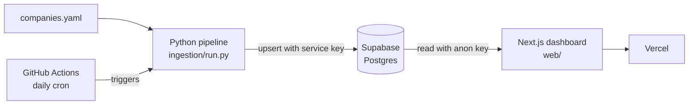

# BC Co-op & Tech Job Tracker

[](https://github.com/OWNER/REPO/actions/workflows/daily-ingest.yml)
[](https://vercel.com/new/clone?repository-url=https://github.com/OWNER/REPO&root-directory=web)

A daily pipeline that scrapes public ATS job boards (Greenhouse, Lever, Ashby, SmartRecruiters) from British Columbia tech companies, keeps the BC and Remote postings, flags co-op and entry-level roles, and extracts the skills each one mentions. The results are stored in Supabase and shown in a Next.js dashboard. Job descriptions are never stored; every posting links back to the original listing.

> Replace `OWNER/REPO` in the badges above with your GitHub repository path.

## Architecture



## Setup

**Prerequisites:** Python 3.12, Node.js 18+, and a free [Supabase](https://supabase.com) project.

1. **Clone and install**
   ```bash
   git clone <your-repo-url>
   cd job-tracker
   pip install -r requirements.txt
   cd web && npm install && cd ..
   ```

2. **Run the migration.** In the Supabase SQL editor, run `supabase/migrations/001_initial_schema.sql`.

3. **Set environment variables** (see the table below).
   - `.env` in the repo root, for the pipeline:
     ```
     SUPABASE_URL=https://xxxx.supabase.co
     SUPABASE_SERVICE_KEY=<service_role key>
     ```
   - `web/.env.local`, for the dashboard (copy `web/.env.local.example`):
     ```
     NEXT_PUBLIC_SUPABASE_URL=https://xxxx.supabase.co
     NEXT_PUBLIC_SUPABASE_ANON_KEY=<anon key>
     ```

4. **(Optional) verify company slugs.** Checks every company in `companies.yaml` against its ATS and writes `companies_verified.yaml`, which the pipeline prefers when present.
   ```bash
   python ingestion/detect_ats.py
   ```

5. **Run the pipeline**
   ```bash
   cd ingestion
   python run.py
   ```

6. **Start the dashboard**
   ```bash
   cd web
   npm run dev
   ```
   Open <http://localhost:3000>.

7. **Run the tests**
   ```bash
   pytest tests/ -v
   ```

## Environment variables

| Variable | Used by | Where to set | Notes |
| --- | --- | --- | --- |
| `SUPABASE_URL` | Pipeline | `.env`, GitHub Actions secret | Project URL |
| `SUPABASE_SERVICE_KEY` | Pipeline | `.env`, GitHub Actions secret | Write access. Never expose to the frontend or use a `NEXT_PUBLIC_` prefix |
| `NEXT_PUBLIC_SUPABASE_URL` | Dashboard | `web/.env.local`, Vercel | Project URL |
| `NEXT_PUBLIC_SUPABASE_ANON_KEY` | Dashboard | `web/.env.local`, Vercel | Read-only via Row-Level Security; safe to expose |

## How the daily cron works

`.github/workflows/daily-ingest.yml` runs every day at 14:00 UTC (7am Pacific during daylight saving time, 6am during standard time). It can also be started manually from the Actions tab.

Each run:

1. Loads `companies_verified.yaml` (or `companies.yaml` if that doesn't exist) and skips entries marked `active: false`.
2. Fetches each company's postings through its ATS adapter, then keeps those in BC or Remote.
3. Flags co-op and entry-level titles and extracts skills from the description, which is discarded afterwards.
4. Upserts postings on `(company_id, external_id)`, refreshing `last_seen`.
5. Marks postings that disappeared from a board as `closed`.
6. Records the run's counts and duration in the `runs` table.

A failure at one company is logged and counted, and never stops the run. The log is uploaded as a workflow artifact and kept for 14 days. Add `SUPABASE_URL` and `SUPABASE_SERVICE_KEY` as repository secrets for the workflow to work.

## Deploying the dashboard

Import the repo into Vercel, set the **Root Directory** to `web`, and add the two `NEXT_PUBLIC_` variables.

## Project layout

```
companies.yaml        Seed list of companies (name, city, ATS, slug)
ingestion/            Python pipeline: adapters, filters, skills, upsert, run
supabase/migrations/  SQL schema
tests/                pytest suite (HTTP mocked)
web/                  Next.js 14 dashboard
```

See [TODO.md](TODO.md) for known follow-ups, including company slugs that still need fixing.
